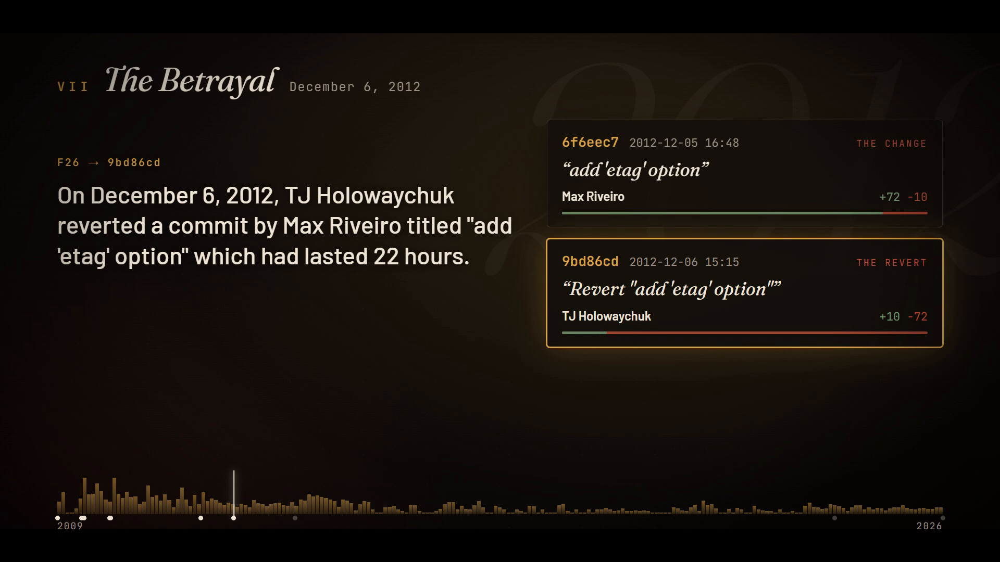
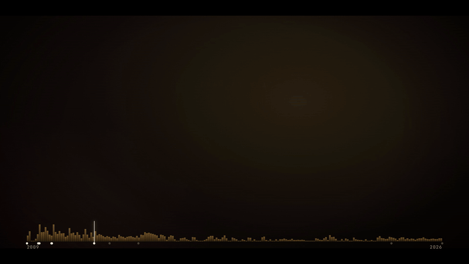

# repo-saga

**Your git history, as a narrated documentary. Every sentence cites a commit.**



<p align="center"></p>

`repo-saga` reads a repository's history and makes a short film about it: the first commit,
the founder's last commit, the week of 158 commits, the change someone reverted 22 hours
later, the 26-day silence, the 13 fix commits in six hours. It writes a narration, voices it,
and renders a ~3-minute video plus a written `saga.md`. Each claim in the saga carries a
footnote that links to the commit it came from.

Everything runs locally: a Python miner, a local LLM (gemma-4-12b on llama-server), local TTS
(Qwen3-TTS through llama.cpp), and [HyperFrames](https://www.npmjs.com/package/hyperframes)
for the render.

## Demos

| Repo | Commits | Film | Saga |
|---|---|---|---|
| [expressjs/express](https://github.com/expressjs/express) | 6,183 over 17 years | [`express-saga.mp4`](demos/express-saga.mp4) (3:04, 10 chapters) | [`demos/express/saga.md`](demos/express/saga.md) |
| [LlamaForge](https://github.com/dadwritestech/LlamaForge) | 470 over 3 months | [`llamaforge-saga.mp4`](demos/llamaforge-saga.mp4) (2:52, 9 chapters) | [`demos/llamaforge/saga.md`](demos/llamaforge/saga.md) |

The committed films are 720p copies; `python -m saga.render` writes 1080p. Each demo folder
also holds the timeline, script and fact-check log. From the express saga:

> The history is scarred by 21 revert commits.¹⁴ On December 6, 2012, TJ Holowaychuk
> reverted a commit by Max Riveiro titled "add 'etag' option" which had lasted 22 hours.¹⁵
>
> ¹⁵ "add 'etag' option" by Max Riveiro lasted 22 hours before TJ Holowaychuk reverted it
> on December 6, 2012. [`9bd86cd`](https://github.com/expressjs/express/commit/9bd86cdddc5f78f37f0c33ba7f094977e7aaf0cb)

## Why you can trust the narration

An LLM asked to write drama about a codebase will invent drama. repo-saga keeps the LLM away
from the history itself:

1. **The miner finds the story; the model only tells it.** `saga/mine.py` turns `git log`
   into *facts*: short sentences, each tied to one commit SHA, such as *"Founder TJ Holowaychuk made
   3,881 commits; the last one was on February 19, 2014, "update node-fresh"."* It groups facts into
   chapters by kind: genesis, first release, purge, crunch week, fix streak, revert,
   force-push, late nights, silence, founder exit, long road to a major version, and present day.
2. **The model writes from that chapter's facts, nothing else, and cites a fact id for every
   sentence.**
3. **A fact checker rejects the sentence** (`check_line` in `saga/write.py`, pinned by
   `tests/`) if:
   - it has no citation, or cites a fact from another chapter;
   - it has a number, or a number word, that isn't in the cited facts;
   - it names an author the cited facts don't mention;
   - it has a quote that isn't verbatim from a commit message, or more than one quote;
   - it claims something *ended* (died, abandoned, "the end of", "conclusion"): the history only shows what was committed;
   - it uses a gendered pronoun (a git log doesn't record pronouns) or an exclamation mark.

   A rejected chapter goes back to the model with the errors listed, up to 3 tries. After
   that, the film uses the raw facts. Each attempt is recorded in `factcheck-log.json`.
4. **Identity merging.** Authors are merged by name and email, so `visionmedia` and
   `TJ Holowaychuk` count as one person. Without it, the miner reported that the express
   founder "left" in 2010, when that was really an alias change. Emails are used for merging
   only; they never reach the output.

On screen, each caption shows its fact id and commit SHA, and the cited commit card lights up
while the narrator reads it.

## Run it

Requirements: Python 3.10+ with numpy, git, ffmpeg, Node 18+ (for `npx hyperframes`),
a llama-server with an instruct model, and, for narration, llama.cpp's `llama-tts` with Qwen3-TTS.

```bash
export LLAMA_API_KEY=...            # your llama-server --api-key; never commit it
python -m saga path/to/repo         # mine -> write -> voice -> render, into out/<repo>/
```

```bash
python -m saga path/to/repo --silent   # skip TTS: captions + music bed only
```

The stages also run one at a time:

```bash
python -m saga.mine   path/to/repo -o out/x/timeline.json      # no LLM; deterministic
python -m saga.write  out/x/timeline.json -o out/x --repo path/to/repo
python -m saga.voice  out/x                                     # resumable, one TTS call per chapter
python -m saga.render out/x                                     # -> out/x/<repo>-saga.mp4
```

Environment: `LLAMA_BASE_URL` (default `http://localhost:8080`), `LLAMA_API_KEY`,
`LLAMA_TTS_BIN`, `QWEN_TTS_MODEL`, `QWEN_TTS_MMPROJ`. For gemma-4 the writer sends
`chat_template_kwargs.enable_thinking=false`. Without it, the model spends most of its time reasoning.

## Status

v0, local only. Known limits:
- The miner reads `HEAD`'s history. Force-push detection needs a local reflog, so on a fresh
  clone it sees none.
- Narration is one llama-tts call per chapter: 10-30 s each here (about 3 minutes per film),
  slower when the GPUs are busy with an LLM. Captions follow sentence times recovered from
  the pauses in the voiced audio, so a sentence can land up to ~0.5 s off.
- The drama comes from the heuristics. For example, a "betrayal" is a revert by a different author.
  The facts are true; the chapter titles are editorial.
- The name collides with [teee32/repo-saga](https://github.com/teee32/repo-saga) (a static
  history poster with no narration). Rename before any release. See
  [`docs/competition.md`](docs/competition.md).
